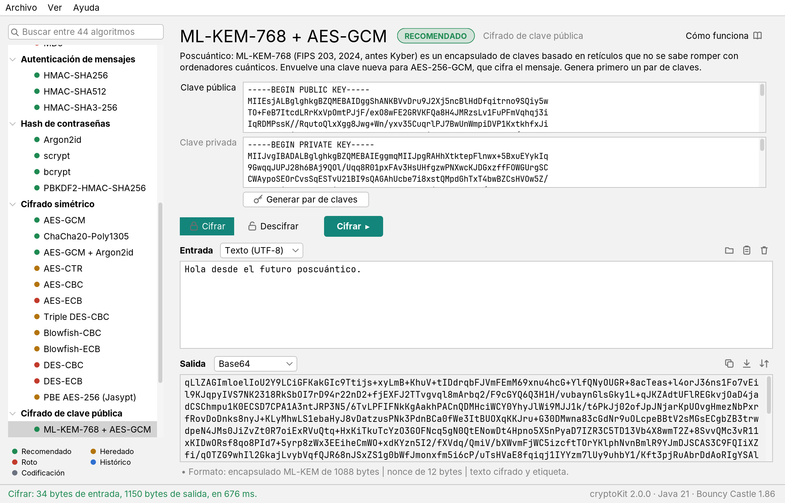

[](https://github.com/toniferr/cryptoKit/actions/workflows/ci.yml)
[](https://github.com/toniferr/cryptoKit/releases/latest)
[](LICENSE)

# cryptoKit

*English version: [README.md](README.md).*

**cryptoKit** es una aplicación de escritorio libre para cifrar, descifrar, resumir y firmar con 44 algoritmos, de
César y Enigma a AES-GCM, Argon2id, Ed25519 y el ML-KEM poscuántico, y **un portal que los explica todos**: la historia
y las matemáticas de la criptografía, con cifrados reales funcionando en tu navegador.

**→ Portal: https://toniferr.github.io/cryptoKit/es/** (español) · [en](https://toniferr.github.io/cryptoKit/)



## Descargar y ejecutar

Descarga la última versión desde la [página de versiones](https://github.com/toniferr/cryptoKit/releases/latest):

- `cryptoKit-2.0.0.jar`: necesita **Java 21 o posterior**. Haz doble clic en él o ejecuta
  `java -jar cryptoKit-2.0.0.jar`.
- `cryptoKit-2.0.0-windows-x64.zip`, `-macos-arm64.zip`, `-linux-x64.zip`: paquetes portables con su propio Java.
  Descomprime y ejecuta `cryptoKit` (en macOS, clic derecho → Abrir la primera vez: la app no está firmada).

La aplicación sale en español si el sistema está en español; se puede cambiar en el menú Ver. Con argumentos, el
mismo jar es una herramienta de línea de comandos (los verbos van en inglés):

```sh
java -jar cryptoKit-2.0.0.jar list                      # los 44 algoritmos
java -jar cryptoKit-2.0.0.jar sha256 hash "hola"
java -jar cryptoKit-2.0.0.jar aes-gcm encrypt --key=00112233445566778899aabbccddeeff --key-format=hex "atacad al alba"
echo -n "caballo correcto grapa batería" | java -jar cryptoKit-2.0.0.jar argon2id hash
java -jar cryptoKit-2.0.0.jar keygen ed25519 > claves.pem
java -jar cryptoKit-2.0.0.jar ed25519 sign --private=@claves.pem "te debo 10 euros"
java -jar cryptoKit-2.0.0.jar --lang=es --help
```

## Qué incluye

| Familia | Algoritmos |
|---|---|
| Cifrados clásicos | César, Vigenère, Playfair, Enigma I |
| Codificaciones | Hex, Base32, Base58, Base64, Base64URL |
| Funciones hash | SHA-256, SHA-512, SHA3-256, SHA3-512, BLAKE2b, BLAKE3, RIPEMD-160, SHA-1, MD5 |
| Autenticación de mensajes | HMAC-SHA256, HMAC-SHA512, HMAC-SHA3-256 |
| Hash de contraseñas | Argon2id, scrypt, bcrypt, PBKDF2-HMAC-SHA256 |
| Cifrado simétrico | AES-GCM, ChaCha20-Poly1305, AES-GCM + Argon2id, AES-CTR/CBC/ECB, Triple DES, Blowfish, DES, PBE (Jasypt, compatible con la 1.0) |
| Cifrado de clave pública | ML-KEM-768 + AES-GCM, X25519 + AES-GCM, RSA-OAEP |
| Firmas digitales | ML-DSA-65, Ed25519, ECDSA P-256, RSA-PSS |

Cada algoritmo lleva una etiqueta de seguridad (recomendado, heredado, roto, histórico, codificación) y un enlace
*Cómo funciona* a su capítulo del portal. Temas claro y oscuro, inglés y español, generadores de claves e IV, pares de
claves en PEM, entrada y salida en texto, hex o Base64. Los textos cifrados con cryptoKit 1.0 se siguen descifrando.
Ver [CHANGELOG.md](CHANGELOG.md).

## El portal

Diez capítulos, cada uno con teoremas y demostraciones, historia y figuras interactivas (25 en total) que ejecutan los
algoritmos reales:

1. Cifrados clásicos: César, el análisis de frecuencias, romper Vigenère con el índice de coincidencia.
2. Enigma: una máquina que funciona, el teorema de permutaciones de Rejewski, el ataque del crib.
3. Secreto perfecto: Shannon, la libreta de un solo uso y la de dos usos.
4. Cifrado en bloque: redes de Feistel, DES, AES ronda a ronda, la avalancha.
5. Modos de operación: el pingüino ECB, el relleno, la maleabilidad, GCM.
6. Funciones hash: la paradoja del cumpleaños, Merkle–Damgård, la caída de MD5 y SHA-1, SHA-3, HMAC.
7. Contraseñas: sal, PBKDF2, bcrypt, scrypt, Argon2.
8. Clave pública: Diffie–Hellman, RSA, firmas.
9. Curvas elípticas: la ley de grupo, ECDH, ECDSA y el nonce, Ed25519.
10. Poscuántica: Shor y Grover, retículos, aprender con errores, ML-KEM y ML-DSA.

Además, una introducción, una línea temporal de 4.000 años y una página sobre la app.

## Compilar desde el código fuente

Requisitos: JDK 21+ y Maven 3.8+ para la app; Python 3.10+ (solo la biblioteca estándar) para el portal; Node 18+ solo
para las pruebas de JavaScript del portal.

```sh
mvn verify                            # compila, pasa las 89 pruebas y genera target/cryptoKit-2.0.0.jar
java -jar target/cryptoKit-2.0.0.jar  # abre la app

python site/build.py --serve          # genera el portal en dist/ y lo sirve en http://127.0.0.1:8000
python site/build.py --release        # generación estricta: falla con cualquier aviso (lo que ejecuta la CI)
node --test site/tests/*.test.mjs     # pruebas con vectores conocidos de la biblioteca de las figuras
```

La estructura del proyecto, el proceso de publicación de versiones y los detalles técnicos están en el
[README en inglés](README.md#project-layout).

## La versión 1.0

La aplicación Swing original (2017–2022) vive en la rama `legacy` y en la
[versión 1.0.0](https://github.com/toniferr/cryptoKit/releases/tag/1.0.0).

## Licencia

[GNU GPL v3](LICENSE). © 2017–2026 Toni Ferreiro. El jar incluye Bouncy Castle (licencia de tipo MIT) y FlatLaf
(Apache 2.0).
