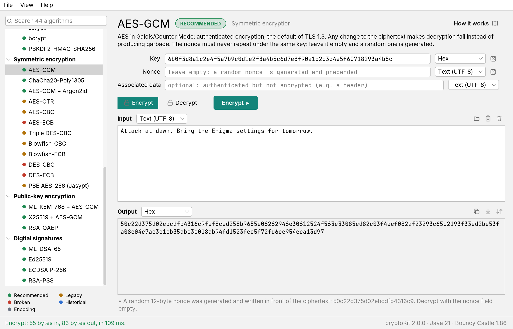

[](https://github.com/toniferr/cryptoKit/actions/workflows/ci.yml)
[](https://github.com/toniferr/cryptoKit/releases/latest)
[](LICENSE)

# cryptoKit

*Versión en español: [README.es.md](README.es.md).*

**cryptoKit** is a free desktop toolkit to encrypt, decrypt, hash and sign with 44 algorithms, from Caesar and
Enigma to AES-GCM, Argon2id, Ed25519 and post-quantum ML-KEM, and **a portal that explains every one of them**: the
history and mathematics of cryptography, with real ciphers running in your browser.

**→ Portal: https://toniferr.github.io/cryptoKit/** (English) · [es](https://toniferr.github.io/cryptoKit/es/)



## Download and run

Get the latest version from the [releases page](https://github.com/toniferr/cryptoKit/releases/latest):

- `cryptoKit-2.0.0.jar`: needs **Java 21 or newer**. Double-click it, or run `java -jar cryptoKit-2.0.0.jar`.
- `cryptoKit-2.0.0-windows-x64.zip`, `-macos-arm64.zip`, `-linux-x64.zip`: portable packages with their own Java.
  Unzip and run `cryptoKit` (on macOS, right-click → Open the first time: the app is not signed).

With arguments, the same jar is a command-line tool:

```sh
java -jar cryptoKit-2.0.0.jar list                      # the 44 algorithms
java -jar cryptoKit-2.0.0.jar sha256 hash "hello"
java -jar cryptoKit-2.0.0.jar aes-gcm encrypt --key=00112233445566778899aabbccddeeff --key-format=hex "attack at dawn"
echo -n "correct horse battery staple" | java -jar cryptoKit-2.0.0.jar argon2id hash
java -jar cryptoKit-2.0.0.jar keygen ed25519 > keys.pem
java -jar cryptoKit-2.0.0.jar ed25519 sign --private=@keys.pem "I owe you 10 euros"
java -jar cryptoKit-2.0.0.jar --help
```

## What's inside

| Family | Algorithms |
|---|---|
| Classical ciphers | Caesar, Vigenère, Playfair, Enigma I |
| Encodings | Hex, Base32, Base58, Base64, Base64URL |
| Hash functions | SHA-256, SHA-512, SHA3-256, SHA3-512, BLAKE2b, BLAKE3, RIPEMD-160, SHA-1, MD5 |
| Message authentication | HMAC-SHA256, HMAC-SHA512, HMAC-SHA3-256 |
| Password hashing | Argon2id, scrypt, bcrypt, PBKDF2-HMAC-SHA256 |
| Symmetric encryption | AES-GCM, ChaCha20-Poly1305, AES-GCM + Argon2id, AES-CTR/CBC/ECB, Triple DES, Blowfish, DES, PBE (Jasypt, 1.0-compatible) |
| Public-key encryption | ML-KEM-768 + AES-GCM, X25519 + AES-GCM, RSA-OAEP |
| Digital signatures | ML-DSA-65, Ed25519, ECDSA P-256, RSA-PSS |

Every algorithm carries a security badge (recommended, legacy, broken, historical, encoding) and a *How it works* link
to its chapter on the portal. Light and dark themes, English and Spanish, key and IV generators, key pairs in PEM, input
and output as text, hex or Base64. Ciphertexts made with cryptoKit 1.0 still decrypt. See [CHANGELOG.md](CHANGELOG.md).

## The portal

Ten chapters, each with theorems and proofs, history and interactive figures (25 in all) that run the real algorithms:

1. Classical ciphers: Caesar, frequency analysis, breaking Vigenère with the index of coincidence.
2. Enigma: a working machine, Rejewski's permutation theorem, crib dragging.
3. Perfect secrecy: Shannon, the one-time pad and the two-time pad.
4. Block ciphers: Feistel networks, DES, AES round by round, the avalanche.
5. Modes of operation: the ECB penguin, padding, malleability, GCM.
6. Hash functions: the birthday paradox, Merkle–Damgård, the fall of MD5 and SHA-1, SHA-3, HMAC.
7. Passwords: salts, PBKDF2, bcrypt, scrypt, Argon2.
8. Public-key cryptography: Diffie–Hellman, RSA, signatures.
9. Elliptic curves: the group law, ECDH, ECDSA and the nonce, Ed25519.
10. Post-quantum: Shor and Grover, lattices, learning with errors, ML-KEM and ML-DSA.

Plus an introduction, a 4,000-year timeline and a page about the app.

## Building from source

Requirements: JDK 21+ and Maven 3.8+ for the app; Python 3.10+ (standard library only) for the portal; Node 18+ only to
run the portal's JavaScript tests.

```sh
mvn verify                            # compile, run the 89 tests, build target/cryptoKit-2.0.0.jar
java -jar target/cryptoKit-2.0.0.jar  # open the app

python site/build.py --serve          # build the portal into dist/ and serve it on http://127.0.0.1:8000
python site/build.py --release        # strict build: fails on any warning (what CI runs)
node --test site/tests/*.test.mjs     # known-answer tests of the figures' crypto library
```

## Project layout

```
src/main/java/es/toni/crypto/
  core/          algorithm model, formats, i18n, the runner shared by GUI and CLI
  algorithms/    one package per family (classical, encoding, hash, password, symmetric, asymmetric, signature)
  cli/           command-line interface
  ui/            Swing + FlatLaf desktop app
src/main/resources/es/toni/crypto/   texts (en, es) and SVG icons
src/test/java/                       tests, plus ui/Screenshots.java, which renders the screenshots
site/
  build.py, texmath.py               static site generator (TeX → MathML at build time)
  content/                           chapters, pages and timeline in en/ and es/, UI strings in i18n/
  src/                               template, CSS, core.js, cklib.js (AES, SHA-256, Enigma…) and the figures
  tests/                             node tests of cklib.js
.github/workflows/                   ci.yml (tests + Pages), release.yml (on a version tag)
```

The portal has no frameworks, no CDN and a strict Content Security Policy; maths is converted to MathML at build time.
It is a sister of [Math of AI](https://toniferr.github.io/math-of-ai/), [Math of Quantum](https://toniferr.github.io/math-of-quantum/),
[Calculus × Computing](https://toniferr.github.io/calculus-computing/) and [Wahoo](https://toniferr.github.io/wahoo/).

## Releasing

Bump the version in `pom.xml` and `site/content/site.json`, add a section to `CHANGELOG.md`, and push a tag with the
same version (no `v`, like `1.0.0`). The release workflow builds the jar and the portable packages and publishes the
GitHub release with that CHANGELOG section as its notes.

## Version 1.0

The original Swing app (2017–2022) lives on the `legacy` branch and in the
[1.0.0 release](https://github.com/toniferr/cryptoKit/releases/tag/1.0.0).

## License

[GNU GPL v3](LICENSE). © 2017–2026 Toni Ferreiro. Bouncy Castle (MIT-style licence) and FlatLaf (Apache 2.0) are
bundled in the jar.
